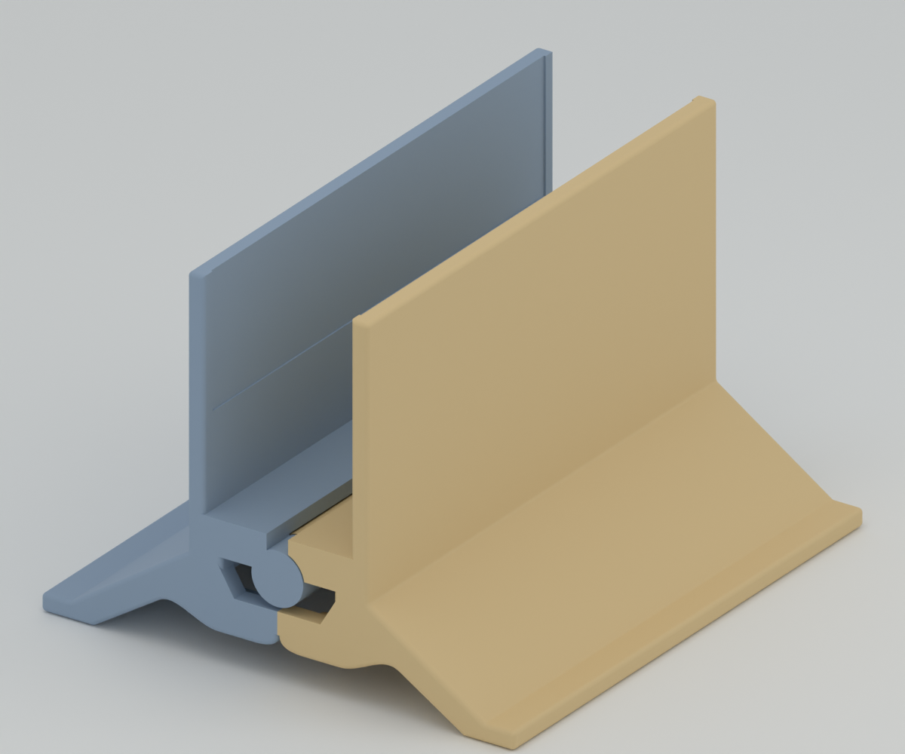

# 하중 작동식 랩탑 세로 스탠드

노트북 무게로 양쪽 벽이 모이고, 노트북을 빼면 하단 고무줄로 다시 벌어지는 3D 프린팅 스탠드입니다. **MacBook Pro 14인치 M5·케이스 없음**, PLA 시제품을 기준으로 설계했습니다.

현재 모델은 **조립 상태 일체 출력 경첩**을 사용합니다. 좌우 몸체가 경첩으로 맞물린 상태 그대로 한 번에 출력되며, 별도 축·고정 캡·클립이 없습니다. 각 경첩은 아래 마디에 붙은 짧은 일체형 축이 위 마디의 막힌 구멍에 들어가는 구조이고, 마디 끝면은 45° 원뿔로 맞물립니다. 바깥 끝으로 축 머리가 나오지 않습니다.



형상·회전 범위와 서포트 없는 슬라이싱을 검사한 디지털 시제품입니다. **출력 직후 경첩이 실제로 풀리는지, 흔들림과 지지 안정성은 아직 확인하지 않았습니다.** 반드시 경첩 시험편을 먼저 출력합니다. [상세 출력 안내](docs/print-in-place.md)에 실물 점검 양식이 있습니다.

## 바로 사용할 파일

[전체 ZIP 다운로드](exports/print-in-place-kit.zip) · [전체 조립 판 STL](exports/print-in-place/assembly-plate.stl) · [전체 판3MF](exports/print-in-place/sliced-assembly/print-in-place-x1c-pla.3mf) · [STEP](exports/print-in-place/assembly-plate.step)

| 판 | 내용 | 파일 |
|---|---|---|
| 경첩 시험편 (먼저 출력) | 실제 앞쪽 경첩과 몸체 연결 목을 잘라 낸 좌우 한 쌍, 맞물린 채 출력 | [hinge-trial.stl](exports/print-in-place/hinge-trial.stl) · [3MF](exports/print-in-place/sliced-trial/print-in-place-trial-x1c-pla.3mf) |
| 전체 조립 판 | 서로 맞물린 왼쪽·오른쪽 몸체 2개 | [assembly-plate.stl](exports/print-in-place/assembly-plate.stl) · [3MF](exports/print-in-place/sliced-assembly/print-in-place-x1c-pla.3mf) |

조립할 부품은 없습니다. 고무줄과 약1mm 접착식 펠트114×30mm 두 장만 별도로 준비합니다.

## 구조와 치수

- **하중으로 닫힘:** 노트북이 중앙 받침을 누르면 양쪽 벽이 모입니다.
- **고무줄로 열림:** 축 아래의 안쪽 캡슐형 걸이를 고무줄로 연결합니다.
- **하단 벌림 턱:** 결합부 아래의 맞물림 턱이 최대 벌림을 제한합니다. 닫히는 폭은 노트북과 펠트의 접촉으로 정합니다.
- **일체 출력 경첩:** v14의 긴 중앙 원통 형태를 유지하고 경첩 반지름6.35mm 안쪽만 다시 만들었습니다. 앞쪽은 왼쪽 마디에서, 뒤쪽은 오른쪽 원통에서 축이 위로 솟습니다.


| 항목 | 현재 설계값 |
|---|---|
| 앞뒤 폭 / 열린 높이 / 좌우 바닥 폭 | 120 / 82 / 110mm |
| 일체형 축 / 구멍 지름 | ø6.0 / ø6.6 (반지름 마진0.3mm) |
| 원뿔 끝면 | 45°, 면에 수직인 틈0.4mm (축 방향0.566mm) |
| 축 끝 | 45° 원뿔, 구멍 천장과 수직 틈0.4mm |
| 두 몸체 최소 간격 | 0.300mm |
| 출력 자세 | 8.2° 오므린 자세, 하단 턱 사이 약2.0mm |

## 출력과 사용

확인 설정은 **Bambu Lab X1C·기본0.4mm 노즐 가정·Generic PLA·Textured PEI Plate·0.20mm Strength 프로필·브림3mm·서포트 끔**입니다. 경첩 축이 베드에 수직으로 서고 폭120mm가 출력 높이가 됩니다.


**서포트는 반드시 끕니다.** 경첩 틈 안에 생긴 서포트는 뺄 수 없습니다. 경첩 안의 아래를 향하는 면은 모두 45°로 만들었고, 두 판 모두 서포트 압출0을 확인했습니다. 0°로 벌린 자세로 출력하지 않는 이유는 두 벌림 턱이 맞닿아 녹아 붙기 때문입니다.

| 출력 판 | 예상 시간 | 예상 PLA |
|---|---|---|
| 경첩 시험편 | 약31분 | 10.7g |
| 전체 조립 판 | 약5시간23분 | 171.8g |

예측값은 로컬 슬라이싱 결과이며 프린터에 전송하지 않았습니다. 보유 필라멘트·노즐·베드에 맞게 다시 슬라이스하되 서포트는 끈 상태를 유지합니다.

1. 시험편을 출력하고, 베드에서 떼어 낸 직후 두 조각을 반대 방향으로 천천히 비틀어 경첩을 풉니다.
2. 경첩이 붙었거나 흔들림이 크면 전체 판을 출력하지 말고 `cad/print-in-place-parameters.json`의 `radial_clearance`·`cone_normal_gap`을 조정합니다.
3. 시험편이 통과하면 전체 판을 출력하고 같은 방법으로 풉니다.
4. 좌우를 분리할 수 없으므로 고무줄은 출력 후 스탠드 아래쪽 공간으로 손을 넣어 두 캡슐형 걸이의 목에 겁니다. 이 방법으로 걸 수 있는지는 디지털로 확인하지 않았습니다.
5. 좌우 안쪽의 얕은 홈에 펠트를 붙이고, 하중 없는 회전·턱 걸림·복원 동작부터 확인합니다.

## 알려진 위험

위 마디 원뿔의 가장 아래 링은 원둘레의 약302°에서 바로 아래에 같은 몸체의 재료가 없습니다. 첫 몇 층이 허공에 걸쳐 출력되므로, 처지면0.566mm 아래 원뿔에 붙을 수 있습니다. 경첩이 몸체와 일부 각도에서만 이어지는 회전체라 형상 변경만으로는 없앨 수 없으며, 시험편으로 먼저 확인합니다.

## 수정 가능한 소스와 재생성

FreeCAD1.1.3, Bambu Studio02.08.02.61, Blender5.2.1을 사용했습니다. 앱 경로는macOS 기준입니다.

```bash
bash scripts/freecad_python.sh cad/build_print_in_place.py
python3 scripts/check_geometry.py --target print-in-place
python3 scripts/slice_calibration.py --kit print-in-place
python3 scripts/slice_calibration.py --kit print-in-place-trial
/Applications/Blender.app/Contents/MacOS/Blender --background --factory-startup --python scripts/render_print_in_place.py
python3 scripts/package_print_in_place.py
```

| 위치 | 내용 |
|---|---|
| [cad/build_print_in_place.py](cad/build_print_in_place.py) | 일체 출력 경첩 생성기 |
| [cad/print-in-place-parameters.json](cad/print-in-place-parameters.json) | 마진·원뿔 틈·출력 자세 설정 |
| [cad/parameters.json](cad/parameters.json) | 공통 몸체·고무줄·회전 설정 |
| [cad/print-in-place.FCStd](cad/print-in-place.FCStd) | 출력 배치 |
| [exports/print-in-place/manifest.json](exports/print-in-place/manifest.json) | 실제 치수·체적 |
| [docs/evidence/print-in-place/geometry-report.json](docs/evidence/print-in-place/geometry-report.json) | 디지털 검사 보고서 |

기본 몸체는 `cad/build_calibration.py`(v14), 고무줄 경로는 `cad/band_geometry.py`를 재사용합니다. FreeCAD 경로가 다르면 `FREECAD_ROOT`를 앱의 `Contents/Resources` 디렉터리로 지정합니다.

## 검증 범위

실제 STL과 CAD에서 다음을 검사합니다.
- 두 몸체가 각각 하나로 이어진 솔리드인지
- 축 방향 배치와 경첩 틈(축–구멍0.3mm, 원뿔0.4mm)
- 0~10.2° 회전 중 두 몸체가 겹치지 않는지, 0°보다 더 벌리면 턱이 걸리는지
- 출력 자세에서 두 몸체 간격과 턱 간격
- 경첩 안 아래쪽 면의 45° 기울기(CAD 면 기준)
- X1C 베드 범위

출력 후 풀림·흔들림·마모, 고무줄 장력, 노트북 지지 안정성은 실물 시험 대상입니다.

## 다른 모델

- **양끝 분리형 (조립식):** 양끝의 짧은 봉2개와 안쪽 열린 클립2개로 조립합니다. [조립 안내](docs/snap-retainer.md) · [ZIP](exports/snap-retainer-kit.zip)
- **v14 (조립식):** 긴 축과 원형 고정 캡을 사용합니다. [기존 안내](docs/calibration.md)

원본 `Been 4mm.stl`과 `Rubber 4mm.stl`은 `references/`에 해시를 유지해 보존했습니다. PETG로 전환하면 마진을 다시 시험합니다.
