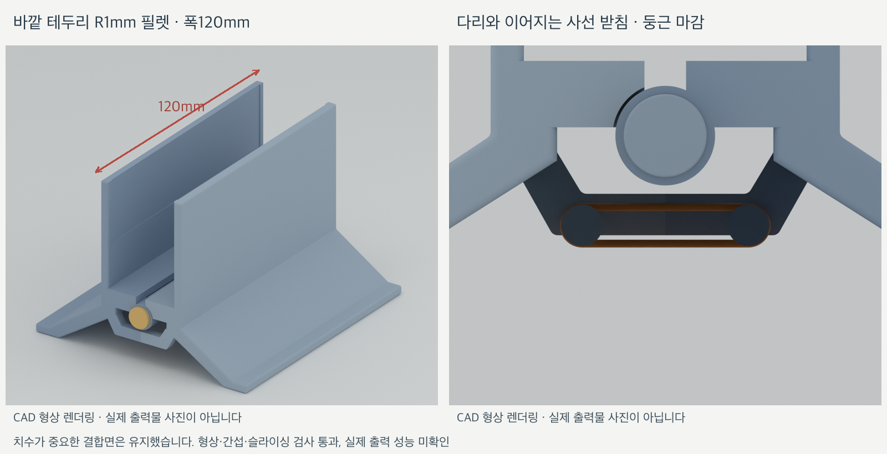

# 하중 작동식 랩탑 세로 스탠드

노트북을 올리면 무게로 중앙 받침이 내려가면서 양쪽 지지벽이 모이고, 노트북을 빼면 하단 고무줄의 복원력으로 다시 벌어지는 3D 프린팅 스탠드입니다. TPU 대신 단단한 출력 부품과 출력 축, 일반 고무줄을 사용합니다.

현재 모델은 **MacBook Pro 14인치 M5·케이스 없음**을 기준으로 만든 **앞뒤 폭 120mm의 PLA 설계 시제품**입니다. 형상 검사와 슬라이싱을 완료했으며, 실제 출력·조립·하중 동작은 아직 확인하지 않았습니다. 실물 시험 결과를 반영한 뒤 PETG 제작을 진행할 계획입니다.



## 설계 특징

- **하중으로 닫힘:** 노트북 하중을 받는 단단한 중앙 받침과 좌우 지지벽이 함께 회전합니다.
- **고무줄로 열림:** 경첩 축 아래의 걸이를 서로 당겨 빈 상태에서 위쪽 지지벽이 벌어지도록 합니다.
- **하단 맞물림 턱:** 결합부 아래의 일체형 턱이 맞닿아 최대 벌림을 제한합니다. 닫히는 폭은 노트북과 펠트의 접촉으로 정합니다.
- **안쪽 고무줄 걸이:** 전면 하단 가로부의 뒷면에서 안쪽을 향하도록 배치했습니다. 걸이 양끝은 다리에 이어지는 사선으로 다듬었습니다.
- **숨긴 축 고정 키:** 원형 캡 안쪽에 고정 키를 일체형으로 넣었습니다. 캡을 옆에서 밀어 끼우며, 바깥에서는 둥근 마감 면만 보입니다.
- **둥근 테두리:** 지지벽과 바닥 발의 노출된 바깥 모서리에 R1mm 필렛을 적용했습니다. 축 구멍과 맞물림 면 등 기능 치수는 유지했습니다.

## 주요 치수

치수 단위는 mm입니다. 여기서 **120mm는 지지벽의 앞뒤 방향 폭**이며, 좌우 발 사이의 폭과 구분합니다.

| 항목 | 설계값 |
|---|---|
| 대상 노트북 | MacBook Pro 14인치 M5, 케이스 없음 |
| 노트북 기준 두께 / 질량 | 15.5mm / 1.55kg |
| 지지벽 앞뒤 폭 | 120mm |
| 열린 상태 전체 높이 | 82mm |
| 열린 상태 좌우 바닥 폭 | 110mm |
| 좌우 지지대 각각의 외곽 크기 | 약 61 × 82 × 120mm |
| 주 축 | 지름 6mm, 지지 길이 120mm, 총길이 126.5mm |
| 원형 고정 캡 | 바깥지름 10mm |
| 펠트 | 약 1mm 두께, 114 × 30mm 두 장 |
| 펠트 자리 깊이 | 0.4mm |
| 바깥 테두리 필렛 | R1mm, 앞쪽 축 머리 테두리 R0.35mm |
| 제작 재료 | PLA 시제품 → 실물 확인 후 PETG 검토 |

## 출력 파일

[전체 파일 묶음 다운로드](exports/calibration-kit.zip) · [상세 출력·조립 안내](docs/calibration.md)

### 조립에 필요한 부품

| 부품 | 파일 | 수량 |
|---|---|---|
| 왼쪽 지지대 | [mechanism-left.stl](exports/calibration/mechanism-left.stl) | 1 |
| 오른쪽 지지대 | [mechanism-right.stl](exports/calibration/mechanism-right.stl) | 1 |
| 지름 6mm 주 축 | [axle-6mm.stl](exports/calibration/axle-6mm.stl) | 1 |
| 원형 고정 캡 | [axle-key.stl](exports/calibration/axle-key.stl) | 1 |
| 일반 사무용 고무줄 | 별도 준비 | 1개부터 조절 |
| 접착식 펠트 | 별도 준비 | 2장 |

`axle-key.stl`은 기존 파일 이름을 유지하고 있으며, 현재 형상은 **내부 키가 포함된 원형 고정 캡**입니다.

### 먼저 끼움 시험하기

**전체 지지대를 출력하기 전에 끼움 시험판부터 출력합니다.** 시험판에는 주 축, 고정 캡, 구멍 크기가 다른 링 세 개가 들어 있습니다.

| 출력 묶음 | STL | Bambu Studio 프로젝트 |
|---|---|---|
| 끼움 시험판: 축·캡·링 3개 | [fit-plate.stl](exports/calibration/fit-plate.stl) | [fit-x1c-pla.3mf](exports/calibration/sliced-fit/fit-x1c-pla.3mf) |
| 전체 판: 지지대 포함 총 7개 | [calibration-plate.stl](exports/calibration/calibration-plate.stl) | [mechanism-x1c-pla.3mf](exports/calibration/sliced-mechanism/mechanism-x1c-pla.3mf) |

| 링 표시 | 개별 파일 | 구멍 지름 | 6mm 축과의 지름 여유 |
|---|---|---|---|
| 점 1개 | [fit-20.stl](exports/calibration/fit-20.stl) | 6.2mm | 0.2mm |
| 점 2개 | [fit-40.stl](exports/calibration/fit-40.stl) | 6.4mm | 0.4mm |
| 점 3개 | [fit-60.stl](exports/calibration/fit-60.stl) | 6.6mm | 0.6mm |

여유 값은 **지름 차이**입니다. 손으로 축을 넣고 부드럽게 회전할 수 있으며 흔들림이 지나치지 않은 링을 찾습니다. 현재 지지대의 축 구멍은 점 2개 링과 같은 **6.4mm**입니다. 다른 여유가 필요하면 `cad/parameters.json`의 `mechanism_clearance`를 조정해 재생성합니다.

## 출력 설정

| 항목 | 확인에 사용한 설정 |
|---|---|
| 프린터 | Bambu Lab X1C |
| 노즐 | 기본 0.4mm 가정 |
| 재료 / 베드 | Generic PLA / Textured PEI Plate |
| 레이어 높이 | 0.20mm |
| 벽 / 채움 | 6겹 / 25% |
| 서포트 | 일반 자동, 빌드플레이트 전용 해제 |
| 브림 | 3mm |

STL에는 출력 방향이 반영되어 있습니다. 지지대는 평평한 전면을 아래로, 축과 링은 축 방향을 수직으로 놓습니다. 고정 캡은 매끈한 바깥 원형 면이 베드에 닿는 방향입니다. **캡 내부 키 아래의 서포트도 제거**해 삽입 통로를 확보합니다.

| 출력 묶음 | 예상 시간 | 예상 PLA 소비량 |
|---|---|---|
| 끼움 시험판 | 약 1시간 12분 | 10.9g |
| 전체 판 | 약 6시간 4분 | 184.7g |

예측값은 현재 형상을 로컬 슬라이싱한 결과입니다. 실제 보유 PLA·노즐·베드에 맞게 설정을 확인하고 다시 슬라이스합니다. 기록은 [끼움 시험판 결과](exports/calibration/sliced-fit/result.json)와 [전체 판 결과](exports/calibration/sliced-mechanism/result.json)에 있습니다.

## 조립과 동작 확인

1. 서포트와 브림을 제거하고 축 구멍, 경첩 마디, 하단 턱, 고무줄 걸이 목 부분을 확인합니다.
2. 좌우를 결합하기 전에 **가로부 뒷면의 안쪽 걸이 한 쌍**에 고무줄을 겁니다. 고무줄은 걸이의 원형 머리와 가로부 사이에 있는 목 부분을 감쌉니다.
3. 경첩 마디를 맞물리고 주 축을 앞에서 뒤로 넣습니다. 완전히 벌어진 상태에서 경첩 아래의 두 턱이 맞닿는지 확인합니다.
4. 반대쪽 축 끝에 고정 캡을 **옆에서 밀어 끼웁니다**. 캡의 평평한 원형 면은 바깥을 향하며, 내부 키가 축의 가로 구멍을 통과합니다. 분해할 때도 캡을 옆으로 밀어 뺍니다.
5. 좌우 안쪽의 얕은 홈에 114 × 30mm 펠트를 붙입니다. 1mm 펠트 기준으로 약 0.6mm가 홈 밖으로 돌출됩니다.
6. 모사판으로 중앙 받침을 눌러 양쪽 벽이 모이고, 놓으면 다시 벌어지는지 확인합니다. 스스로 복원되는 가장 약한 고무줄 장력부터 조절한 뒤 실제 노트북의 접촉과 흔들림을 확인합니다.

일반 고무줄의 길이와 탄성이 일정하지 않아 감는 횟수를 고정하지 않았습니다. 너무 강하면 노트북 무게로 닫히지 않을 수 있습니다. 축의 회전 저항, 캡의 유지력, 바닥 마찰도 실물에서 함께 확인해야 합니다.

## CAD 수정과 재생성

형상은 FreeCAD의 OpenCascade 솔리드 커널로 생성합니다. 이 환경에서 사용한 도구는 **FreeCAD 1.1.3, Bambu Studio 02.08.02.61, Blender 5.2.1**입니다.

주요 설정은 [cad/parameters.json](cad/parameters.json)에 있습니다.

| 파라미터 | 현재 값 | 의미 |
|---|---|---|
| `depth` | 120.0 | 지지벽 앞뒤 폭 |
| `pin_diameter` | 6.0 | 출력 축 지름 |
| `mechanism_clearance` | 0.4 | 지지대 축 구멍의 지름 여유 |
| `outer_edge_fillet` | 1.0 | 바깥 테두리 필렛 반지름 |
| `felt_thickness` | 1.0 | 접촉 계산에 사용하는 펠트 두께 |
| `sample_loaded_angle_deg` | 8.2 | 거치 예시 자세의 검사 각도 |

`sample_loaded_angle_deg`는 물리적인 닫힘 제한 각도가 아닙니다. 닫히는 폭은 노트북과 펠트의 접촉으로 정해집니다.

프로젝트 루트에서 실행합니다.

```bash
# CAD와 출력용 STL·STEP 생성
bash scripts/freecad_python.sh cad/build_calibration.py

# 실제 생성 파일의 형상 검사
python3 scripts/check_geometry.py --target calibration

# 두 출력판 슬라이싱
python3 scripts/slice_calibration.py --kit fit
python3 scripts/slice_calibration.py --kit mechanism

# 개별 모델 뷰 렌더링
/Applications/Blender.app/Contents/MacOS/Blender --background --factory-startup --python scripts/render_models.py

# 검사 결과와 출력 파일을 최신 ZIP으로 묶기
python3 scripts/package_calibration.py
```

스크립트의 기본 앱 경로는 macOS 기준입니다. FreeCAD 설치 경로가 다르면 `FREECAD_ROOT`를 해당 앱의 `Contents/Resources` 디렉터리로 지정합니다. Bambu Studio와 Blender도 다른 위치에 설치했다면 경로를 맞춰야 합니다.

## 파일 구성

| 위치 | 내용 |
|---|---|
| [cad/build_calibration.py](cad/build_calibration.py) | 부품과 조립 형상 생성 소스 |
| [cad/band_geometry.py](cad/band_geometry.py) | 검사와 렌더링에서 공유하는 고무줄 경로 |
| [cad/calibration.FCStd](cad/calibration.FCStd) | FreeCAD 출력 배치 |
| [cad/mechanism-assembly.FCStd](cad/mechanism-assembly.FCStd) | 열린 상태의 조립 모델 |
| [exports/calibration/calibration.step](exports/calibration/calibration.step) | 출력 배치의 STEP 파일 |
| [exports/calibration/manifest.json](exports/calibration/manifest.json) | 부품 치수·체적·배치 정보 |
| [scripts/](scripts/) | 형상 검사·슬라이싱·렌더링·패키징 도구 |
| [docs/calibration.md](docs/calibration.md) | 상세 출력·조립·시험 안내 |
| [docs/evidence/](docs/evidence/) | 렌더링 이미지와 디지털 검사 결과 |
| [references/](references/) | 원본 STL과 출처·해시 기록 |

제공받은 `Been 4mm.stl`과 `Rubber 4mm.stl`은 각각 `references/body-original.stl`, `references/connector-original.stl`로 보존했습니다. 현재 모델은 이 원본과 사진을 참고해 별도로 재구성한 동작 시험용 CAD입니다. 원본 지지대의 길이와 곡면을 그대로 복제한 모델은 아닙니다.

## 검증 상태

현재 [형상 검사 결과](docs/evidence/geometry-report.json)는 `pass`입니다.

- 개별 부품 7개와 출력 배치 2개의 메시 건전성 및 솔리드 형상을 검사했습니다.
- 33개 자세에서 몸체 간 간섭, 바닥 여유, 축 통과, 노트북 모사판의 접촉과 고무줄 예시 경로를 검사했습니다.
- 몸체 결합 경로 81개 위치와 축·고정 캡 삽입 경로 각각 41개 위치를 검사했습니다.
- 하단 벌림 턱의 맞물림, 120mm 폭, 안쪽 걸이 방향, 사선 받침과 R1mm 필렛을 확인했습니다.
- 두 출력판 모두 로컬 슬라이싱을 완료했습니다.

이 결과는 **디지털 형상과 출력 경로의 확인**입니다. 실제 고무줄 장력, 마찰, 캡 유지력, 노트북 지지 안정성 및 반복 내구성을 입증하지 않습니다. 렌더링의 주황색 고무줄도 배치 설명용입니다.

실제 출력 후 [결과 양식](docs/calibration.md#출력-후-알려-줄-결과)으로 끼움·회전·복원 동작을 기록합니다. PETG로 전환할 때는 동일한 끼움 시험을 다시 진행합니다.
