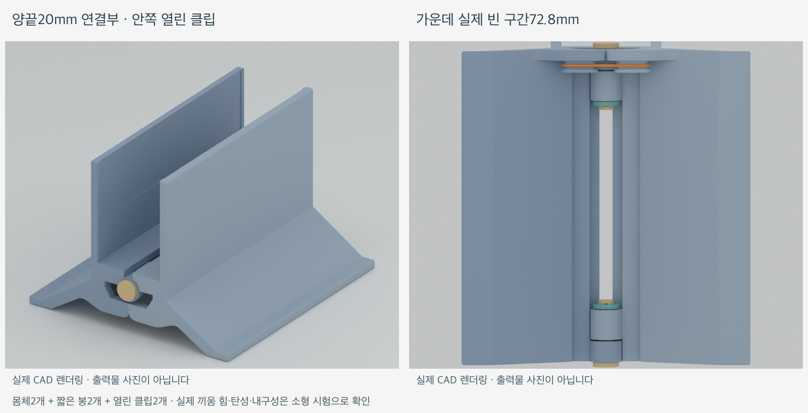

# 하중 작동식 랩탑 세로 스탠드

노트북 무게로 양쪽 벽이 모이고, 노트북을 빼면 하단 고무줄로 다시 벌어지는 3D 프린팅 스탠드입니다. **MacBook Pro 14인치 M5·케이스 없음**, PLA 시제품을 기준으로 설계했습니다.

현재 모델은 **양끝의 짧은 연결부와 안쪽 열린 클립**을 사용합니다. 가운데 긴 원통과 긴 축을 없애고, 기존 형태를 짧게 만든 봉2개를 양끝에 배치했습니다. 클립은 평평하게 출력하며 복잡한 내부 쐐기 캡을 대신합니다.



형상·조립 경로와 슬라이싱을 검사한 디지털 시제품입니다. 실제 출력·끼움 힘·탄성 복원·지지 안정성은 아직 확인하지 않았습니다. [상세 출력·조립 안내](docs/snap-retainer.md)에 실물 확인 양식이 있습니다.

## 바로 사용할 파일

[전체 ZIP 다운로드](exports/snap-retainer-kit.zip) · [6개 부품 STL 모음](exports/snap-retainer/assembly-plate.stl) · [전체 판3MF](exports/snap-retainer/sliced-assembly/snap-retainer-x1c-pla.3mf)

| 부품 | 개별 파일 | 수량 |
|---|---|---|
| 왼쪽 몸체 | [body-left.stl](exports/snap-retainer/body-left.stl) | 1 |
| 오른쪽 몸체 | [body-right.stl](exports/snap-retainer/body-right.stl) | 1 |
| 짧은 봉 | [short-pin.stl](exports/snap-retainer/short-pin.stl) | 2 |
| 열린 클립 | [snap-clip.stl](exports/snap-retainer/snap-clip.stl) | 2 |

기본 모음에는 **조립에 사용하는6개**만 있습니다. 고무줄과 약1mm 접착식 펠트114×30mm 두 장은 별도 준비합니다. 기존v14 왼쪽 몸체를 이미 출력했다면 재사용할 수 있습니다.

### 선택 사항: 작은 시험판

[시험판 STL](exports/snap-retainer/snap-fit-plate.stl) · [시험판3MF](exports/snap-retainer/sliced-fit/snap-fit-x1c-pla.3mf)

실제 앞쪽 경첩을 잘라낸 시험편2개와 봉1개·클립1개의4개 부품입니다. 전체 몸체를 출력하기 전에 끼움과 클립 벌림을 확인할 수 있으며, 기본 조립 모음에는 포함하지 않습니다.

## 구조와 치수

- **하중으로 닫힘:** 노트북이 중앙 받침을 누르면 양쪽 벽이 모입니다.
- **고무줄로 열림:** 축 아래의 안쪽 캡슐형 걸이를 고무줄로 연결합니다.
- **하단 벌림 턱:** 결합부 아래의 맞물림 턱이 최대 벌림을 제한합니다. 닫히는 폭은 노트북과 펠트의 접촉으로 정합니다.
- **양끝 연결:** 두 짧은 연결부의 축은 일직선이며 가운데를 긴 축으로 잇지 않습니다.
- **안쪽 클립:** 봉은 바깥에서 안쪽으로 넣고, 슬롯 방향을 맞춘 뒤 빈 가운데 공간의 아래에서 위로 클립을 끼웁니다. 바깥에는 둥근 봉 머리가 보입니다.

| 항목 | 현재 설계값 |
|---|---|
| 앞뒤 폭 / 열린 높이 / 좌우 바닥 폭 | 120 / 82 / 110mm |
| 양끝 연결부 | 각각20mm |
| 가운데 원통이 없는 구간 | 80mm |
| 봉 끝까지 제외한 실제 빈 구간 | 72.8mm |
| 봉 | 지름6mm, 총길이25.6mm, 수량2개 |
| 경첩 끝면 간격 / 축 구멍 지름 | 0.6mm / 6.4mm |
| 클립 외곽 / 두께 | 약9.12×10mm / 1.8mm |
| 클립 입구 / 중앙 혀 높이 | 5.0mm / 1.6mm |

봉의 둥근 머리와 끝 가로 슬롯 형상은 기존 설계를 유지했습니다. 클립은 열린 가운데와 중앙 걸림 혀를 가지며, 입구를 지날 때 양팔이 벌어져야 하는 구상입니다. 기하학적 필요 벌림량은 한쪽 약0.5mm이며 실제 PLA 허용 변형을 검증한 값은 아닙니다.

## 출력·조립

확인 설정은 **Bambu Lab X1C·기본0.4mm 노즐 가정·Generic PLA·Textured PEI Plate·레이어0.20mm·벽6겹·채움25%·브림3mm**입니다. 몸체와 시험편은 일반 자동 서포트, 빌드플레이트 전용 해제로 확인했습니다.

**클립은 넓은 평면을 베드에 놓습니다.** 저장된 STL에 이 방향이 반영되어 있으며 세워 출력하지 않습니다. 두께 방향 단면이 동일한 평면 구조이고, 두 판의 클립 위치에서 서포트 압출 끝점0건을 확인했습니다.

| 출력 판 | 예상 시간 | 예상 PLA |
|---|---|---|
| 전체6개 부품 | 약5시간36분 | 175.5g |
| 별도 소형 시험판 | 약40분 | 13.2g |

예측값은 로컬 슬라이싱 결과입니다. 프린터에 전송하지 않았습니다. 보유 필라멘트·노즐·베드에 맞게 다시 슬라이스합니다.

1. 서포트와 브림을 제거하고 봉의 끝 슬롯을 확인합니다.
2. 고무줄을 걸고 좌우 끝마디를 맞춥니다.
3. 봉을 양쪽 바깥에서 가운데를 향해 넣고 슬롯을 위아래 방향으로 맞춥니다.
4. 각 클립의 입구와 중앙 혀를 위로 향하게 한 뒤, **안쪽 아래에서 위로** 끼웁니다. 옆쪽 접근은 몸체 목에 막히므로 사용하지 않습니다.
5. 펠트와 고무줄 장력을 맞추고 하중 없는 회전·클립 고정·복원 동작부터 확인합니다.

조립 확대와 상세 순서, 실물 확인 항목은 [조립 안내](docs/snap-retainer.md)를 읽습니다.

## 수정 가능한 소스와 재생성

FreeCAD1.1.3, Bambu Studio02.08.02.61, Blender5.2.1을 사용했습니다. 앱 경로는macOS 기준입니다.

```bash
bash scripts/freecad_python.sh cad/build_snap_retainer.py
python3 scripts/check_geometry.py --target snap-retainer
python3 scripts/slice_calibration.py --kit snap-retainer
python3 scripts/slice_calibration.py --kit snap-fit
/Applications/Blender.app/Contents/MacOS/Blender --background --factory-startup --python scripts/render_snap_retainer.py
python3 scripts/package_snap_retainer.py
```

| 위치 | 내용 |
|---|---|
| [cad/build_snap_retainer.py](cad/build_snap_retainer.py) | 새 연결부·짧은 봉·열린 클립 생성기 |
| [cad/snap-parameters.json](cad/snap-parameters.json) | 새 연결부와 클립 설정 |
| [cad/parameters.json](cad/parameters.json) | 공통 몸체·고무줄·회전 설정 |
| [cad/snap-retainer-print.FCStd](cad/snap-retainer-print.FCStd) | 6개 출력 배치 |
| [cad/snap-retainer-assembly.FCStd](cad/snap-retainer-assembly.FCStd) | 열린 조립 상태 |
| [exports/snap-retainer/assembly-plate.step](exports/snap-retainer/assembly-plate.step) | 출력 배치 STEP |
| [exports/snap-retainer/manifest.json](exports/snap-retainer/manifest.json) | 실제 치수·체적·수량 |
| [docs/evidence/snap-retainer/geometry-report.json](docs/evidence/snap-retainer/geometry-report.json) | 디지털 검사 보고서 |

기본 몸체와 봉의 기존 형태는 `cad/build_calibration.py`, 고무줄 경로는 `cad/band_geometry.py`를 재사용합니다. FreeCAD 경로가 다르면 `FREECAD_ROOT`를 앱의 `Contents/Resources` 디렉터리로 지정합니다.

## 검증 범위와 이전 모델

실제STL과CAD의 형상·체적·경계, 중앙 빈 구간,6개 조립 구성,33개 회전 자세, 양끝 봉/클립의 삽입 경로, 축 방향 걸림과 모사 노트북 접촉을 검사합니다. 클립의 탄성 접촉 구간은 정지 상태의 우발적 충돌과 구분합니다. 실제 끼움 힘·유지력·반복 수명·노트북 지지 안정성은 실물 시험 대상입니다.

원본 `Been 4mm.stl`과 `Rubber 4mm.stl`은 `references/`에 해시를 유지해 보존했습니다. 기존v14의 긴 축·고정 캡 파일과 배포ZIP도 보존했으며, 이전 모델의 출력·조립 방법은 [기존 안내](docs/calibration.md)에 있습니다. PETG 전환 시에는 별도 끼움 시험을 다시 진행합니다.
