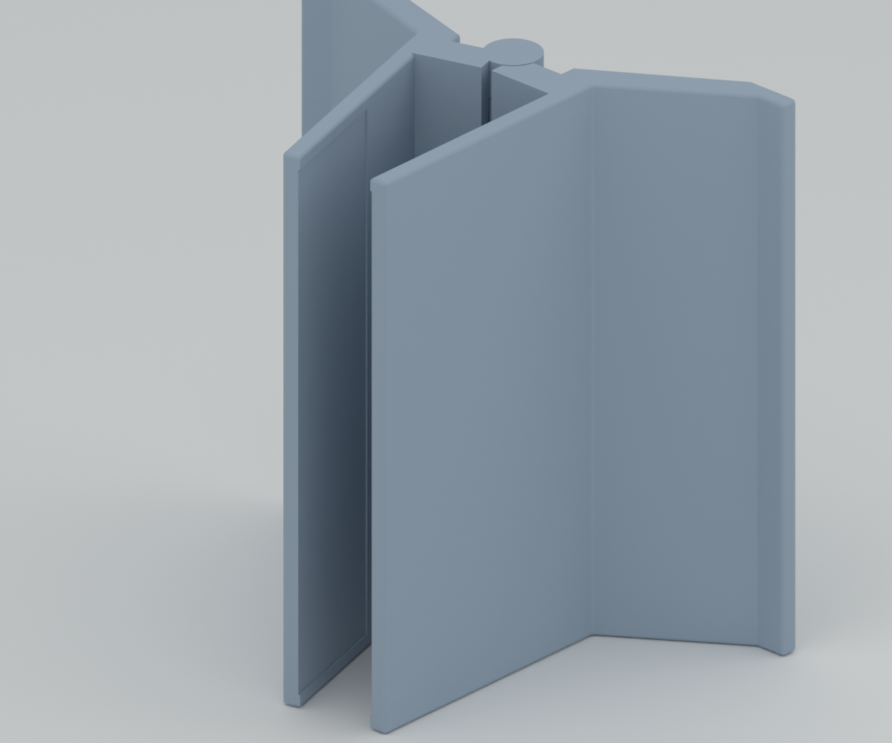
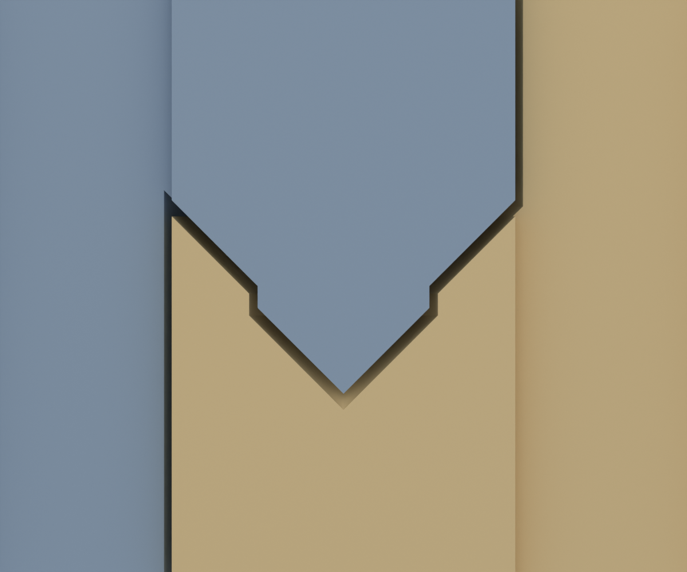

# 조립 상태 일체 출력 경첩

v14의 긴 중앙 원통 형태를 기준으로 **별도 축과 고정 캡을 없앴습니다.** 좌우 몸체는 경첩으로 맞물린 상태 그대로 X1C에서 한 번에 출력합니다. 각 경첩은 아래 마디에 붙은 짧은 일체형 축이 위 마디의 막힌 구멍에 들어가는 구조이며, 마디 끝면은 45° 원뿔로 맞물립니다. 바깥 끝으로 축 머리가 나오지 않습니다.



이미지는 실제 CAD 렌더링입니다. 아래 수치는 디지털 형상 검사 결과이며, **출력 직후 경첩이 실제로 풀리는지, 흔들림과 마모가 어떤지는 아직 확인하지 않았습니다.** 반드시 시험편을 먼저 출력합니다.

## 파일

| 용도 | 파일 |
|---|---|
| 전체 조립 판 | [assembly-plate.stl](../exports/print-in-place/assembly-plate.stl) · [슬라이스된 3MF](../exports/print-in-place/sliced-assembly/print-in-place-x1c-pla.3mf) · [STEP](../exports/print-in-place/assembly-plate.step) |
| 경첩 시험편 | [hinge-trial.stl](../exports/print-in-place/hinge-trial.stl) · [슬라이스된 3MF](../exports/print-in-place/sliced-trial/print-in-place-trial-x1c-pla.3mf) |
| 치수·체적 | [manifest.json](../exports/print-in-place/manifest.json) · [형상 검사 보고서](evidence/print-in-place/geometry-report.json) |

전체 판에는 서로 맞물린 몸체 2개만 있습니다. 축·캡·클립·시험 링은 없습니다. 고무줄과 약 1mm 펠트는 지금처럼 별도로 준비합니다. 시험편은 실제 앞쪽 경첩과 몸체 연결 목까지 잘라 낸 좌우 한 쌍이며, 역시 맞물린 채 출력됩니다.

## 경첩 구조와 치수



축을 지나는 단면입니다. 파란색은 왼쪽 몸체, 노란색은 오른쪽 몸체입니다.

| 항목 | 값 |
|---|---|
| 일체형 축 / 구멍 지름 | ø6.0 / ø6.6 (반지름 마진 0.3mm) |
| 원뿔 끝면 | 45°, 면에 수직인 틈 0.4mm (축 방향 0.566mm) |
| 축 끝 | 45° 원뿔, 구멍 천장과 수직 틈 0.4mm |
| 경첩 배치 | 앞쪽: 왼쪽 마디 → 오른쪽 원통 / 뒤쪽: 오른쪽 원통 → 왼쪽 마디 (축은 항상 아래 마디에서 위로) |
| 출력 자세 | 8.2° 오므린 자세. 하단 벌림 제한 턱 사이 약 2.0mm |
| 두 몸체 최소 간격 | 0.300mm (경첩 축–구멍) |

경첩 축이 베드에 수직으로 서고, 원래 폭 120mm가 출력 높이가 됩니다. 경첩 안의 아래를 향하는 면은 모두 45°이므로 서포트 없이 출력하도록 만들었습니다. 0°로 벌린 자세로 출력하지 않는 이유는 두 벌림 제한 턱이 맞닿아 녹아 붙기 때문입니다.

## 출력

| 판 | 예상 시간 | 필라멘트 |
|---|---|---|
| 경첩 시험편 | 약 31분 | 10.7g |
| 전체 조립 판 | 약 5시간 23분 | 171.8g |

Bambu Studio 기준이며 X1C·0.4mm 노즐·Generic PLA·0.20mm Strength 프로필에서 **서포트를 끄고** 슬라이스했습니다. 슬라이스 결과에서 서포트 압출은 0입니다. 다른 프로필로 다시 슬라이스할 때도 서포트는 반드시 끕니다. 경첩 틈 안에 생긴 서포트는 뺄 수 없습니다. 바닥 첫 층의 퍼짐 보정(elefant foot compensation 0.15mm)은 켜 둡니다. 맨 아래에서 왼쪽 마디와 오른쪽 몸체 사이 틈이 0.35mm밖에 되지 않기 때문입니다.

1. 시험편을 먼저 출력합니다.
2. 출력 직후 베드에서 떼어 내고, 두 조각을 반대 방향으로 천천히 비틀어 경첩을 풉니다. 처음 한두 번 뻑뻑한 것은 정상일 수 있습니다.
3. 아래 점검 양식을 채웁니다. 경첩이 붙었거나 흔들림이 크면 전체 판을 출력하지 말고 마진을 조정합니다(`cad/print-in-place-parameters.json`의 `radial_clearance`, `cone_normal_gap`).
4. 시험편이 통과하면 전체 판을 출력하고 같은 방법으로 풉니다.
5. 좌우를 분리할 수 없으므로 기존 안내처럼 결합 전에 고무줄을 걸 수 없습니다. 출력 후 스탠드 아래쪽 공간으로 손을 넣어 두 캡슐형 걸이의 목에 겁니다. 이 방법으로 걸 수 있는지는 디지털로 확인하지 않았습니다. 펠트는 좌우 안쪽의 얕은 홈에 붙입니다.

## 알려진 출력 위험

위 마디 원뿔의 가장 아래 링은 원둘레의 약 302°에서 바로 밖·아래에 같은 몸체의 재료가 없습니다(검사 보고서 `upper_rim_unsupported_arc_deg`). 첫 몇 층이 허공에 걸쳐 출력된다는 뜻입니다. 이 링이 처지면 0.566mm 아래의 원뿔과 붙을 수 있습니다. 회전 대칭 경첩이 몸체의 일부 각도에서만 연결되는 구조라 형상 변경만으로 없앨 수 없습니다. 시험편이 이 위험을 확인하는 가장 빠른 방법입니다.

## 실물 점검 양식

| 항목 | 시험편 | 전체 판 |
|---|---|---|
| 출력 직후 손으로 풀림 (예/힘 필요/붙음) | | |
| 원뿔 끝면 처짐이나 거스러미 | | |
| 0°~8° 회전이 걸림 없이 되는가 | | |
| 축 방향·좌우 흔들림 정도 | | |
| 벌림 제한 턱이 0°에서 멈추는가 | — | |
| 노트북 거치 후 오므림·복원 | — | |

## 재생성

```bash
bash scripts/freecad_python.sh cad/build_print_in_place.py
python3 scripts/check_geometry.py --target print-in-place
python3 scripts/slice_calibration.py --kit print-in-place
python3 scripts/slice_calibration.py --kit print-in-place-trial
/Applications/Blender.app/Contents/MacOS/Blender --background --factory-startup --python scripts/render_print_in_place.py
python3 scripts/package_print_in_place.py
```

생성기 [cad/build_print_in_place.py](../cad/build_print_in_place.py)는 v14 몸체(`cad/build_calibration.py`)를 그대로 불러온 뒤, 경첩 반지름 6.35mm 안쪽만 회전체로 다시 만듭니다. 설정은 [cad/print-in-place-parameters.json](../cad/print-in-place-parameters.json)에 있습니다. 기존 v14 및 양끝 분리형 파일은 변경하지 않았습니다.
