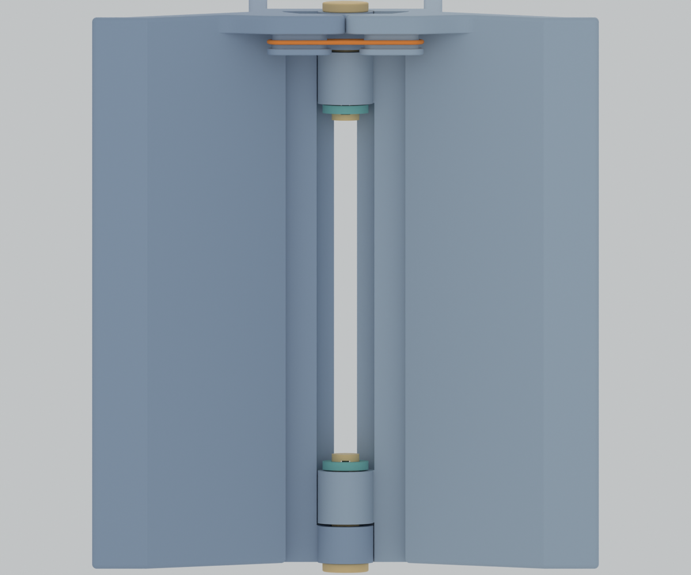
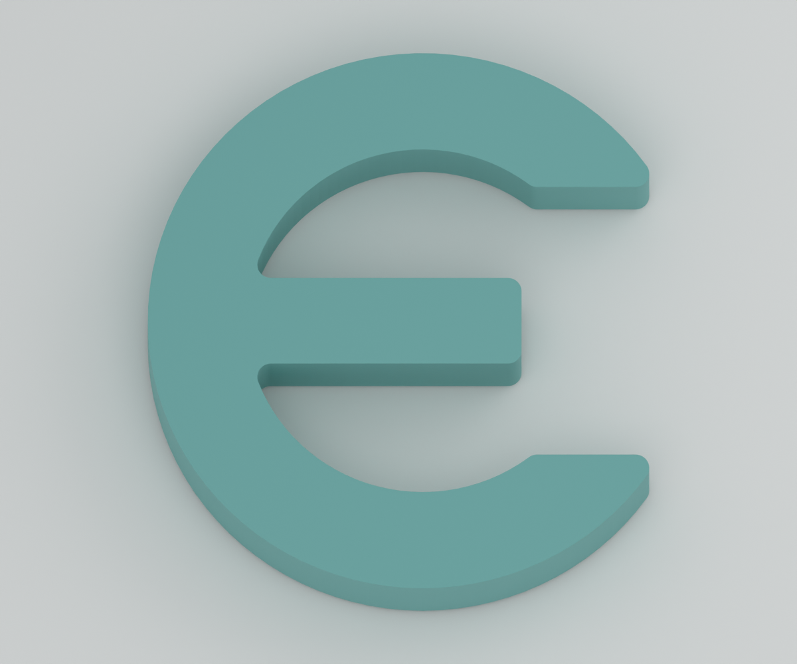
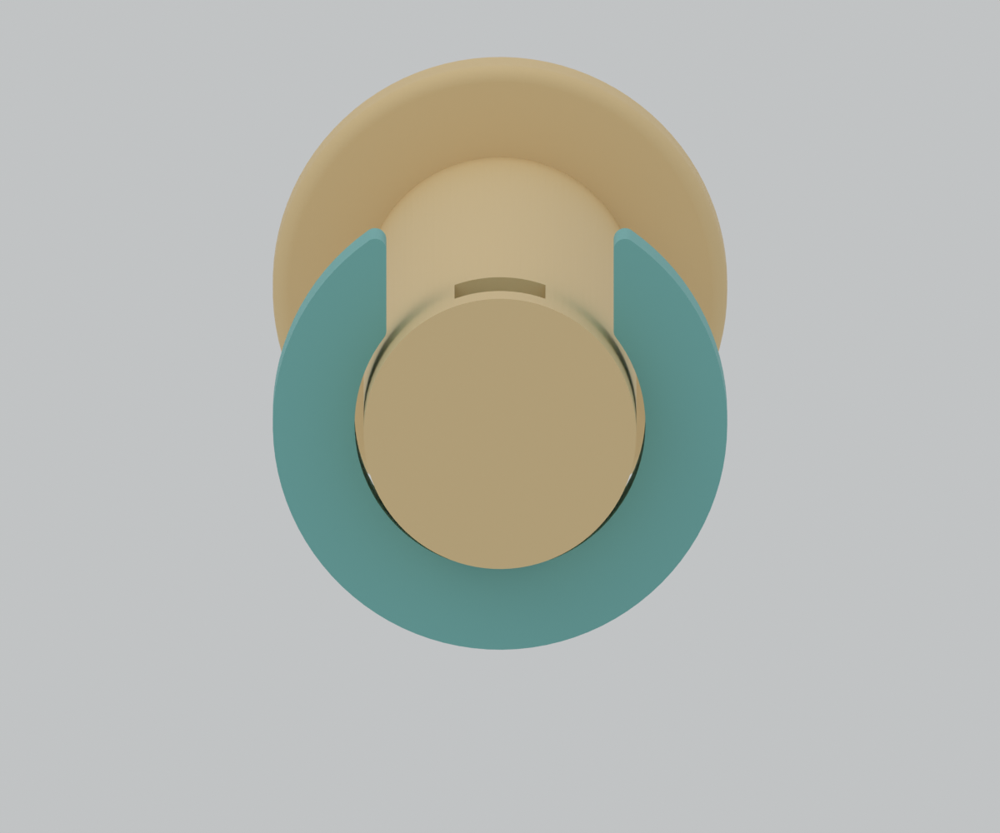

# 양끝 분리 경첩과 안쪽 열린 클립

이 설계는 가운데 긴 원통과 축을 없애고 **앞뒤 폭120mm의 양끝에20mm 연결부를 하나씩** 배치합니다. 봉은 기존의 원통·둥근 머리·끝 가로 슬롯 형상을 유지한 채 길이를 줄였습니다. 두 클립은 가운데 빈 공간 쪽에 놓이며, 바깥에는 둥근 봉 머리가 보입니다.



이미지는 실제 CAD 렌더링입니다. 실제 출력·끼움 힘·탄성 복원·반복 내구성은 아직 확인하지 않았습니다. PLA 시제품 기준이며 PETG로 바꾸면 끼움을 다시 확인합니다.

## 파일과 수량

| 부품 | 파일 | 조립 수량 |
|---|---|---|
| 왼쪽 몸체 | [body-left.stl](../exports/snap-retainer/body-left.stl) | 1 |
| 오른쪽 몸체 | [body-right.stl](../exports/snap-retainer/body-right.stl) | 1 |
| 짧은 봉 | [short-pin.stl](../exports/snap-retainer/short-pin.stl) | 2 |
| 열린 클립 | [snap-clip.stl](../exports/snap-retainer/snap-clip.stl) | 2 |

[전체6개 부품 STL](../exports/snap-retainer/assembly-plate.stl) · [전체 판3MF](../exports/snap-retainer/sliced-assembly/snap-retainer-x1c-pla.3mf)

기본 조립 모음에는6개만 있습니다. 기존 긴 축과 고정 캡, 시험 링은 포함하지 않습니다. 왼쪽 몸체는v14 형상을 유지하므로 이미 출력했다면 재사용할 수 있습니다. 오른쪽 몸체와 봉2개·클립2개를 새로 출력합니다. 기존v14 파일은 `exports/calibration/`에 보존했습니다.

## 먼저 확인할 작은 시험판

[소형 시험판 STL](../exports/snap-retainer/snap-fit-plate.stl) · [소형 시험판3MF](../exports/snap-retainer/sliced-fit/snap-fit-x1c-pla.3mf)

시험판은 실제 앞쪽 경첩을 잘라낸 좌우 시험편, 짧은 봉1개, 클립1개의4개 부품입니다. 단순 구멍 링 대신 실제 끝마디·슬롯·클립의 결합을 확인합니다. 전체 판과 별도 파일입니다.

## 주요 치수

| 항목 | 값 |
|---|---|
| 대상 | MacBook Pro 14인치 M5, 케이스 없음 |
| 전체 앞뒤 폭 / 열린 상태 높이 / 좌우 바닥 폭 | 120 / 82 / 110mm |
| 양끝 연결부 | 각각20mm |
| 가운데 원통이 없는 구간 | Y=20~100mm, 길이80mm |
| 봉 끝까지 제외한 실제 중앙 빈 구간 | Y=23.6~96.4mm, 길이72.8mm |
| 짧은 봉 | 지름6mm, 총길이25.6mm |
| 봉 머리 | 지름10mm, 기존 둥근 테두리 유지 |
| 끝 슬롯 | 축 방향 폭2.3mm, 좁은 방향 높이2.0mm |
| 경첩 끝면 간격 / 축 구멍 지름 | 0.6mm / 6.4mm |
| 클립 외곽 크기 / 두께 | 약9.12×10mm / 1.8mm |
| 클립 입구 / 중앙 혀 높이 | 5.0mm / 1.6mm |
| 클립과 베어링 끝면 사이 | 0.25mm |

클립 중앙 혀는 슬롯보다 좁은 방향에서 한 면당0.2mm, 두께 방향에서는 한 면당0.25mm 작습니다. 입구5mm가 봉6mm를 지나려면 기하학적으로 양팔이 약0.5mm씩 벌어져야 합니다. 이는 필요한 변위이며 PLA의 허용 변형이나 필요한 힘을 검증한 값은 아닙니다.

## 출력

- 프린터: Bambu Lab X1C, 기본0.4mm 노즐 가정.
- 확인한 설정: Generic PLA, Textured PEI Plate, 레이어0.20mm, 벽6겹, 채움25%, 브림3mm.
- 몸체와 시험편: STL에 저장된 평평한 앞면을 베드에 놓는 방향을 사용합니다. 일반 자동 서포트, 빌드플레이트 전용 해제입니다.
- 봉: 둥근 머리가 아래이며 축이 수직입니다. 길이가 짧아져도 머리와 끝 슬롯 형태는 기존과 같습니다.
- **클립: 넓은 E형 평면이 베드에 닿는 방향입니다. 세워 출력하지 않습니다.** 두께 방향 단면이 동일하며 공중에 뜬 내부 키가 없습니다. 전체/시험판 G-code의 클립 위치에서 서포트 압출 끝점0건을 확인했습니다.



| 판 | 예상 시간 | 예상 PLA |
|---|---|---|
| 전체6개 부품 | 약5시간36분 | 175.5g |
| 별도 소형 시험판 | 약40분 | 13.2g |

두 판 모두 슬라이싱 종료0, 경고 없음입니다. 예측값이며 프린터에 전송하거나 실제 출력한 결과가 아닙니다. 보유 PLA·노즐·베드에 맞춰 다시 슬라이스합니다.

## 조립

1. 서포트와 브림을 제거합니다. 특히 짧은 봉 끝 슬롯 안에 잔여물이 없는지 확인합니다. 소형 시험판으로 먼저 손으로 들어가는지 확인할 수 있습니다.
2. 기존 방식대로 안쪽 캡슐형 고무줄 걸이에 고무줄을 걸고 좌우 몸체의 끝마디를 맞춥니다. 빈 상태에서 하단 벌림 턱이 맞닿아야 합니다.
3. 앞쪽 봉을 **바깥에서 가운데를 향해** 넣습니다. 둥근 머리가 바깥에 남고 슬롯이 가운데 빈 공간 쪽으로 나옵니다. 끝 슬롯의 긴 방향이 위아래가 되도록 봉을 돌려 맞춥니다.
4. 클립의 열린 입구와 중앙 혀를 위로 향하게 놓고, **안쪽 공간의 아래에서 위로** 밀어 끼웁니다. 중앙 혀가 봉의 슬롯을 통과하며 양팔이 봉을 감싸는 구상입니다. 옆에서 밀면 몸체 목에 막히므로 아래쪽 접근 방향을 사용합니다.
5. 뒤쪽도 바깥에서 봉을 넣고 안쪽 아래에서 클립을 끼웁니다. 양쪽 모두 바깥 둥근 머리·안쪽 클립 배치입니다.
6. 두 클립이 끝까지 앉았는지 확인한 뒤 하중 없이 양쪽 벽을 움직입니다. 가운데 긴 축을 추가하지 않습니다. 분해할 때는 클립 양팔을 조금 벌리면서 아래로 빼는 방향입니다. 실제 삽입·제거력은 시험 대상입니다.
7. 기존 펠트와 고무줄 장력을 맞춥니다. 모사판으로 중앙을 누르면 양쪽이 모이고 놓으면 벌어지는지 먼저 확인한 뒤 실제 노트북의 접촉·흔들림을 확인합니다.



## 디지털 검사

[형상 보고서](evidence/snap-retainer/geometry-report.json)는 실제 솔리드와 배포 파일을 함께 검사합니다.

- 단품6종과 배치2개, 총8개 STL의 닫힘·면 방향·체적·연결 성분·퇴화 면·자기 교차를 확인합니다. 단품은 몸체2종·봉·클립·별도 시험편2종이며 조립 수량과 구분합니다.
- 전체 판의6개 연결 성분, 소형 판의4개, CAD의 이름·수량·실제 배치와 STEP의 솔리드를 확인합니다. STL의 체적·경계를 새 CAD와 대조합니다.
- 중앙의 실제 빈 구간을 솔리드 교차로 확인하고 봉 지름·머리·슬롯, 클립 입구와 평면 단면을 측정합니다.
- 33개 회전 자세에서 몸체·봉·클립·고무줄·모사 노트북 접촉과 바닥 여유를 확인합니다. 아래쪽 클립 접근과 양끝 봉 삽입은 각각41개 위치에서 확인합니다.
- 슬롯 안의 중앙 혀가 축 방향으로 걸리고, 클립이 베어링 끝면에 걸리며, 반대 방향은 둥근 머리가 막는지 기하학적으로 확인합니다.
- 삽입 도중 양팔과 봉이 겹치는 구간은 필요한 탄성 접촉으로 따로 기록합니다. 정지 위치의 우발적 충돌이나 중앙 혀의 슬롯 충돌을 이 구간과 섞어 무시하지 않습니다.

실제 끼움 힘·복원·파단·반복 내구성·바닥 마찰·노트북 지지 안정성은 아직 확인하지 않았습니다. 기하학적으로 걸리는 것과 실제 유지력은 다릅니다.

## 재생성

프로젝트 루트에서 FreeCAD1.1.3, Bambu Studio02.08.02.61, Blender5.2.1을 사용했습니다. 기본 앱 경로는macOS입니다.

```bash
bash scripts/freecad_python.sh cad/build_snap_retainer.py
python3 scripts/check_geometry.py --target snap-retainer
python3 scripts/slice_calibration.py --kit snap-retainer
python3 scripts/slice_calibration.py --kit snap-fit
/Applications/Blender.app/Contents/MacOS/Blender --background --factory-startup --python scripts/render_snap_retainer.py
python3 scripts/package_snap_retainer.py
```

기본 몸체·고무줄 경로와 봉 형태는 `cad/build_calibration.py`, `cad/parameters.json`, `cad/band_geometry.py`를 재사용합니다. 새 설정은 [snap-parameters.json](../cad/snap-parameters.json), 새 생성기는 [build_snap_retainer.py](../cad/build_snap_retainer.py)입니다. `module_length`를 바꾸면 봉 길이와 중앙 빈 구간도 다시 생성·검사해야 합니다.

- [출력 배치 CAD](../cad/snap-retainer-print.FCStd)
- [열린 조립 CAD](../cad/snap-retainer-assembly.FCStd)
- [출력 배치 STEP](../exports/snap-retainer/assembly-plate.step)
- [치수·수량 기록](../exports/snap-retainer/manifest.json)

## 실물 확인 양식

```text
PLA / 노즐 / 레이어 / 베드:
봉과 경첩의 끼움·회전:
중앙 혀가 슬롯에 들어가는지:
아래에서 클립을 끼우고 빼기 쉬운지:
클립의 갈라짐·흰 변형 자국:
손으로 당겼을 때 쉽게 빠지는지:
두 끝 축이 어긋나거나 움직일 때 걸리는지:
고무줄 복원 / 하중으로 오므림 / 바닥 걸림:
```

PETG 전환 시에는 같은 소형 시험을 다시 진행합니다.
